# Gléas

A phone app that builds you a 14-day skincare routine from the products you already own, then walks you through it every morning and evening, and tunes it at the end of each cycle.

**[Try the demo](https://ainefoley.github.io/Gleas/)** · [or start as a new user](https://ainefoley.github.io/Gleas/?new)

The demo runs entirely in your browser, and it's made for phones. On a computer it shows inside a phone-sized frame.

<p align="center">
  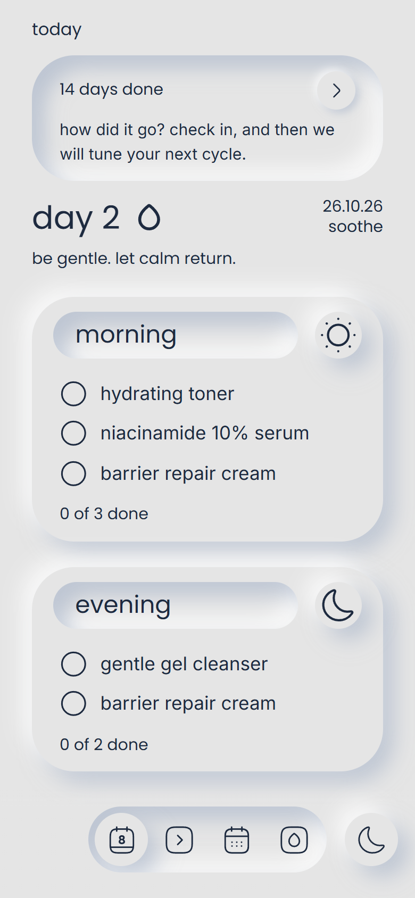
  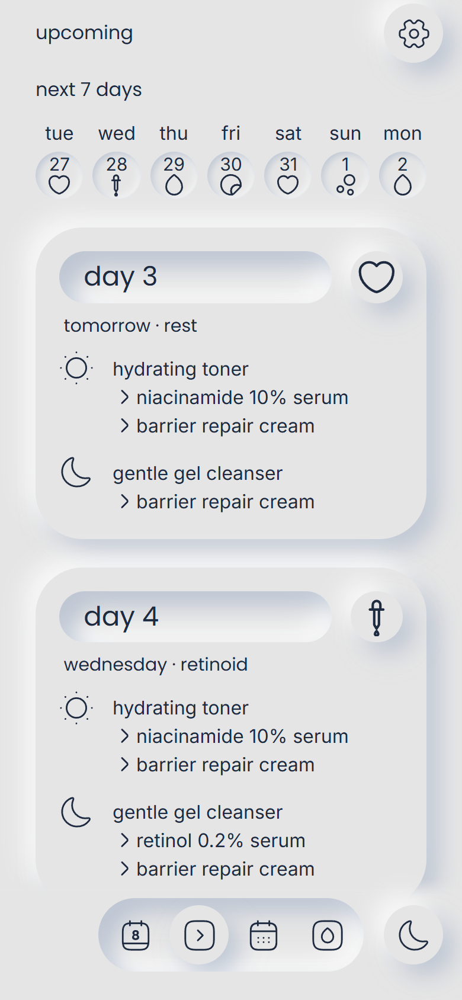
  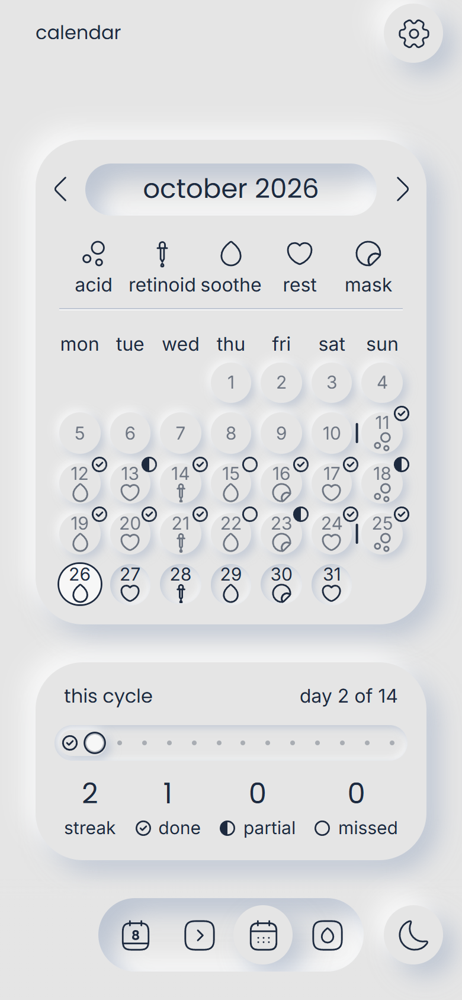
</p>

## What it does

- **Builds a routine from your shelf.** Answer eight questions about your skin, then add your products by pasting a shop link, typing a name or taking a photo. An AI plans 14 days around them, alternating active days (acids, retinoids) with gentler ones.
- **Walks you through each day.** Today shows the morning and evening routines with the next step flagged. You tick steps off as you go, and the calendar records how each day went.
- **Tunes itself every cycle.** After 14 days it asks how your skin has been. The AI then suggests the next cycle's plan and explains what it changed and why.
- **Suggests what's missing.** It names up to three kinds of product worth adding, such as sunscreen, with a reason based on your answers and what's in the products you own.
- **Works offline.** It installs to the Home Screen and opens like an app. Your progress lives on the phone and syncs to the server when there's a connection.

<p align="center">
  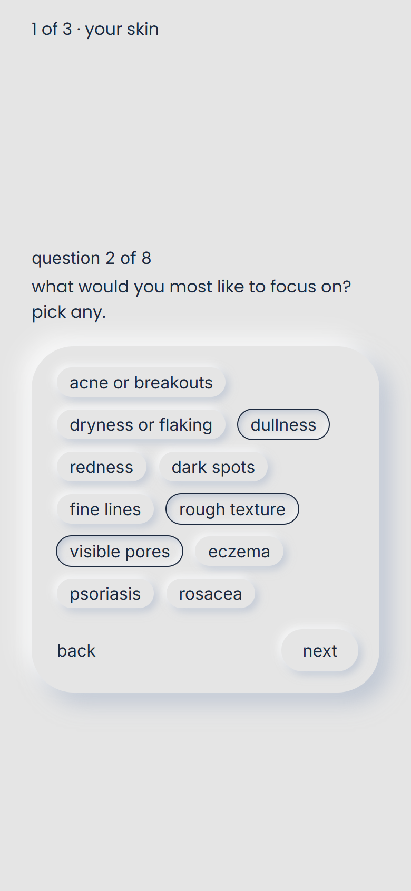
  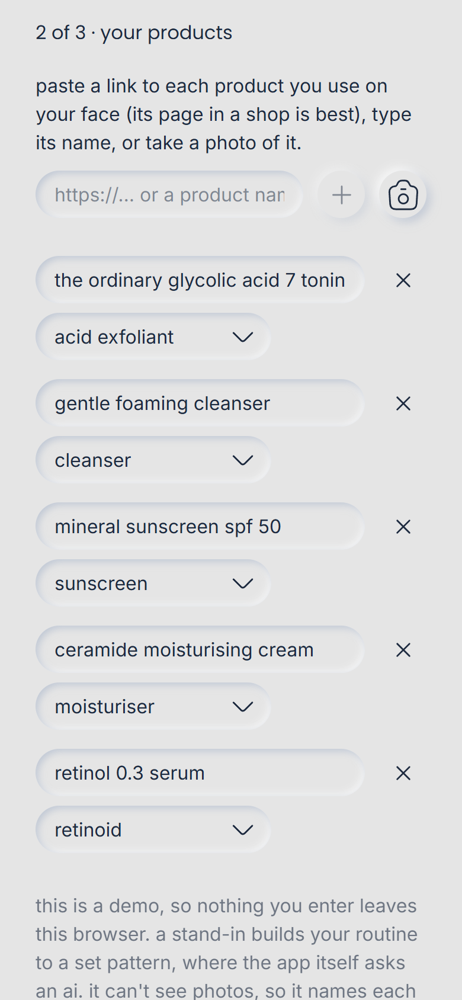
  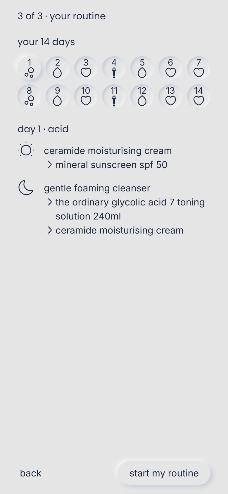
</p>

## How the AI is kept safe

A routine affects people's skin, so the AI suggests plans and the code decides whether they're allowed. Every plan is checked against rules the AI can't overrule:

- Acids only on Acid days and retinoids only on Retinoid days, never both on one day.
- Never two of those days in a row, including from Day 14 back to Day 1.
- No retinoids while pregnant or breastfeeding.
- Only the person's own products, each used at most once per routine.

A plan that breaks a rule goes back to the AI once, with the problems listed. If it still fails, nobody gets it. The phone runs the same checks again before saving a plan.

Some suggestions are blocked whatever the AI says. Acid exfoliants and retinoids are never suggested while skin is irritated, alongside eczema, psoriasis or rosacea, or with a prescription treatment.

<p align="center">
  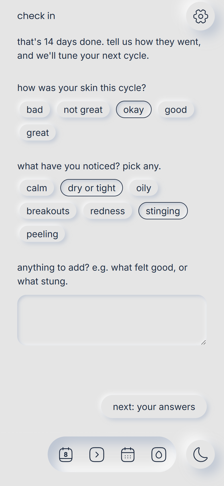
  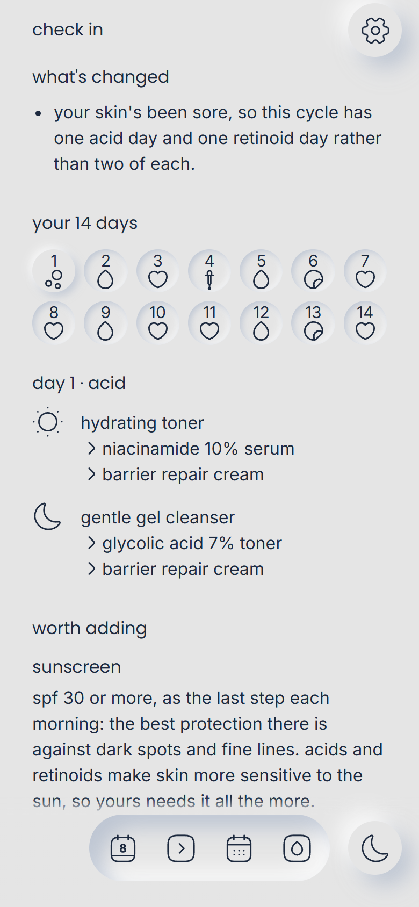
  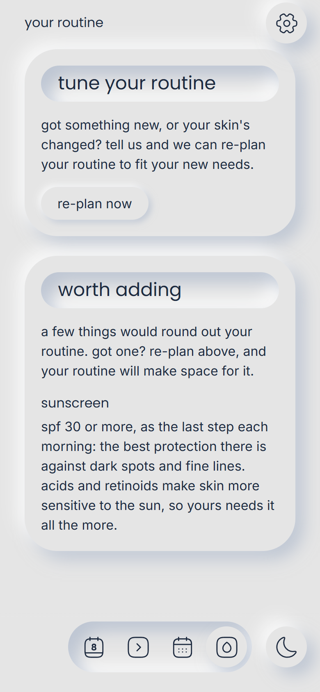
</p>

## Under the hood

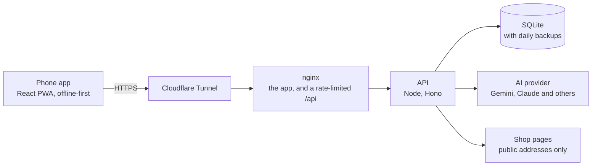

- **Offline-first sync.** The phone is the source of truth. Each change syncs to the server a couple of seconds later, using revision numbers. When two phones change at once, the server rejects the stale save and the phone merges both copies (every tick, reset and routine) before saving again.
- **Any AI provider.** Gemini, Claude, Groq, Mistral, OpenRouter and a local Ollama all sit behind one small interface, so switching is a settings change. Each invite code has a daily allowance of AI requests, so no one person can use up a free tier.
- **Reading products from links.** The server fetches the shop's page, reads its structured data (JSON-LD and Open Graph), and asks the AI what the product is and what's notable in it. It only ever connects to public addresses, and it checks each address as it connects, so a link can't be pointed at the server's own network. Pages are capped in size, redirects and time. Photos go to a vision model, after the phone shrinks them.
- **Self-hosted and locked down.** Docker Compose runs nginx, the API and a Cloudflare Tunnel, so no ports are open on the home network. The API and tunnel containers are read-only with every Linux capability dropped. The tunnel can't reach the API directly, only through nginx, which rate-limits requests.
- **Interface details.** A soft, tactile neumorphic look, with pages that sink and rise as you move between them. Today is sized to fit the screen: the app measures the page and closes up spacing, then shrinks the text, as little as it needs to. The theme follows the time of day, and a day lasts until 4am, so a late evening routine counts for the right day.
- **Tested.** Strict TypeScript throughout, ESLint's strictest type-checked rules, and over 200 unit tests covering the plan rules, sync and merging, product extraction, the API and the AI adapters.

| | |
| --- | --- |
| App | React 19, TypeScript, Vite, Tailwind CSS, Framer Motion, React Router, Zod |
| Offline | Service worker (vite-plugin-pwa), localStorage |
| Server | Node.js, Hono, SQLite (`node:sqlite`) |
| AI | Gemini, Claude, Groq, Mistral, OpenRouter or Ollama |
| Hosting | Docker Compose, nginx, Cloudflare Tunnel |
| Quality | Vitest, ESLint, Prettier |

## A peek at the code

The code is private, but here are a few pieces of it.

**The rules every plan must pass.** These checks run on every plan before anyone sees it, on the server and again on the phone. Day 14 runs straight into Day 1, so the check for two strong days in a row wraps around.

```ts
/**
 * What's wrong with a plan, as sentences the AI can act on; empty if
 * nothing. These hold whoever made the plan:
 * - Days 1–14 in order, each with a morning and an evening step.
 * - Only their own products, each at most once per routine.
 * - Acid exfoliants on Acid days and retinoids on Retinoid days, and those
 *   days use one, so the two never share a day.
 * - No two Acid or Retinoid days in a row, Day 14 to Day 1 included.
 * - No retinoids while pregnant or breastfeeding.
 */
export function checkPlan(plan: Plan, answers?: Answers): string[] {
    const problems: string[] = [];

    // … the checks on each day

    const isActive = (index: number) => {
        const type = plan.days.at(index % plan.days.length)?.type;
        return type === 'acid' || type === 'retinoid';
    };
    plan.days.forEach((_, index) => {
        if (isActive(index) && isActive(index + 1))
            problems.push(
                `Day ${String(index + 1)} and the day after are both Acid or Retinoid days: put a gentle day between them.`,
            );
    });

    return problems;
}
```

And the kinds of product it never suggests adding, whatever the AI says:

```ts
const CONDITIONS: readonly (keyof typeof CONCERNS)[] = [
    'eczema',
    'psoriasis',
    'rosacea',
];

/**
 * Kinds of product never worth suggesting they add, whoever suggests it:
 * acid exfoliants and retinoids while their skin's irritated, with eczema,
 * psoriasis or rosacea, or alongside a prescription treatment, and retinoids
 * while pregnant or breastfeeding.
 */
export function ruledOutKinds(answers: Answers): ReadonlySet<ProductKind> {
    const kinds = new Set<ProductKind>();
    if (
        answers.irritated ||
        answers.prescription.trim() !== '' ||
        answers.concerns.some((concern) => CONDITIONS.includes(concern))
    )
        kinds.add('exfoliant').add('retinoid');
    if (answers.pregnant) kinds.add('retinoid');
    return kinds;
}
```

**Two phones saving at once.** Each save on the server adds 1 to its revision, and a phone saves only if the server is still at the revision it last saw. If another phone saved first, the server turns the save down and sends back its copy. The phone merges the two, keeping every tick from both, and tries again, up to three times.

```ts
// Each round, once this phone's data has changed:
const result = await deps.save(meta.rev, state);
const now = deps.local();
if (result.saved) {
    // Changed again while it saved: saved next round.
    const changed = now.state !== state;
    deps.store({ ...now.meta, rev: result.rev, changed });
    if (!changed) return;
    continue;
}
const theirs = read(result.current);
if (!theirs) return;
deps.store(
    { ...now.meta, rev: result.current.rev, changed: true },
    now.meta.changedAt > result.current.updatedAt
        ? mergeStates(theirs, now.state)
        : mergeStates(now.state, theirs),
);
```

**Sinking and rising.** Every raised shape and pressed well in the app sinks into the page and rises back out as you move around. One function makes the animation for all of them. To sink a shape, it takes the shape's shadow and sets every length in it to `0px`, so the shadow shrinks to nothing and the shape sits flat. Rising springs it back up.

```ts
/**
 * Motion variants for something that sinks into the surface (`sunk`) and rises
 * back out of it (`raised`): sinking eases in, rising springs up. Give
 * `variants` alone to sink and rise with the motion component around it.
 */
export function sinkRise({
    shadow,
    scale,
    fade = false,
}: SinkRiseOptions): Variants {
    const fadeSeconds = SINK_SECONDS / 2;
    return {
        sunk: {
            ...(shadow && { boxShadow: shadow.replace(/-?\d+px/g, '0px') }),
            ...(scale !== undefined && { scale }),
            ...(fade && { opacity: 0 }),
            transition: {
                duration: SINK_SECONDS,
                ease: 'easeIn',
                opacity: { duration: fadeSeconds, delay: fadeSeconds },
            },
        },
        raised: {
            ...(shadow && { boxShadow: shadow }),
            ...(scale !== undefined && { scale: 1 }),
            ...(fade && { opacity: 1 }),
            transition: {
                type: 'spring',
                duration: 0.5,
                bounce: 0.3,
                opacity: { duration: fadeSeconds },
            },
        },
    };
}

/**
 * A pop-up's card, raised over its page: it shrinks a little and fades as it
 * flattens, so the page shows through again, and rises back the same way.
 */
export const POPUP = sinkRise({
    shadow: SHADOWS.raised,
    scale: 0.95,
    fade: true,
});
```

## About the demo

The demo is the real app with its server swapped out. A stand-in in your browser answers the app's requests, so nothing you enter leaves the browser.

- It opens two weeks into a sample routine with made-up history, on the day the app offers its end-of-cycle check-in.
- The stand-in plans routines to a set pattern that still passes all the rules above, where the real app asks an AI. It can't read shop pages or see photos, so it names products from the link's address and picks photos from a list of samples.
- To try setting up from scratch, open [the new-user link](https://ainefoley.github.io/Gleas/?new). Or open Settings (the gear in the top corner of every page except Today) and choose **Start as someone new** or **Reset the demo**.

<p align="center">
  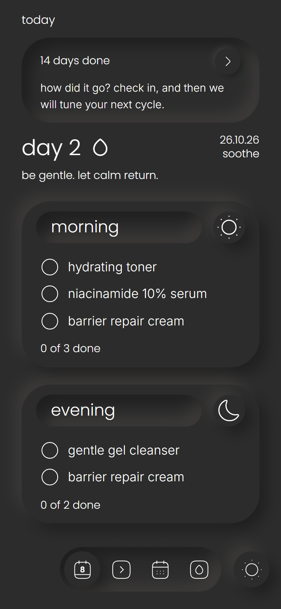
  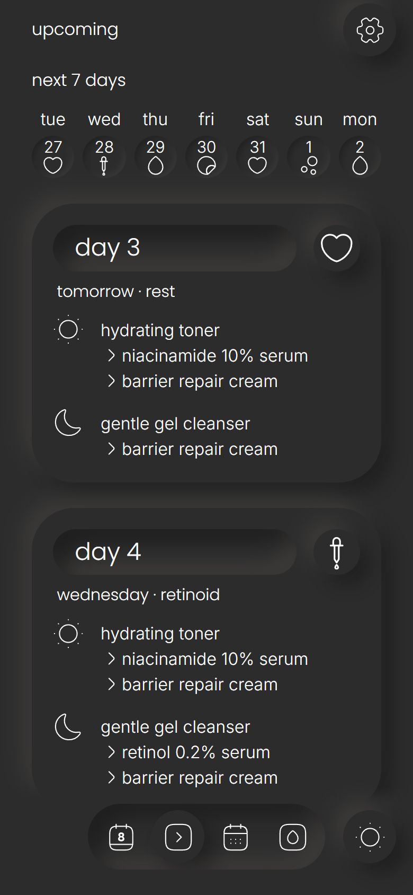
  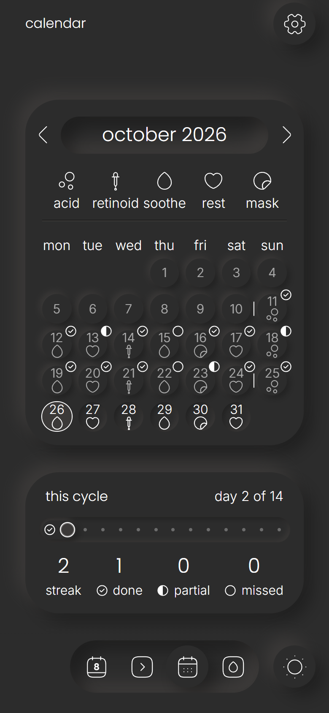
</p>
